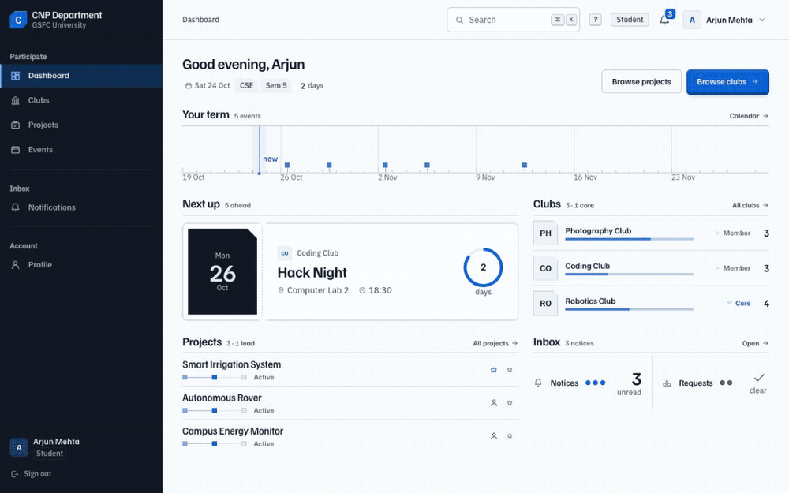
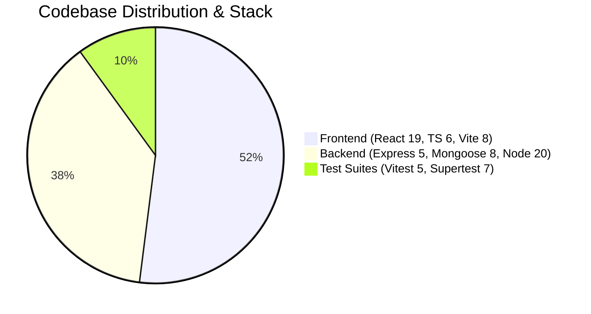
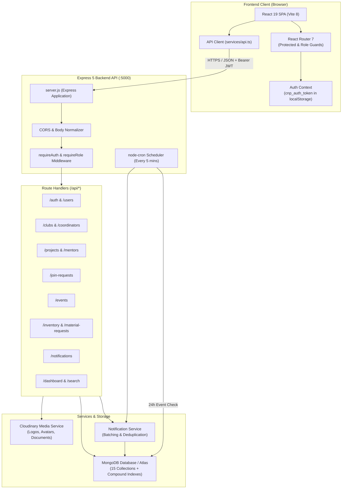
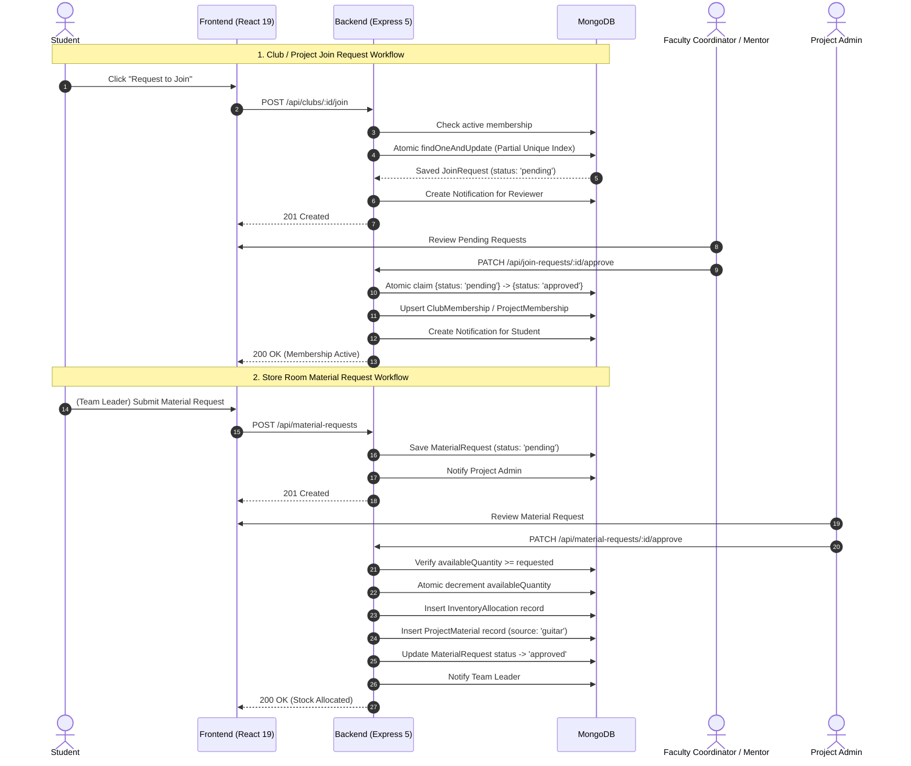
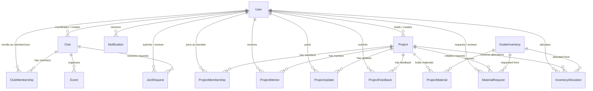

# CNP Department

**The Centralized Platform for Student Managed Clubs (SMCs) and GUIITAR Projects at GSFC University.**

<p align="left">
  
  
  
  
  
  
  
  
</p>

CNP Department is a purpose-built web platform designed for GSFC University's Centre for Networked Programmes. It unifies the governance, collaboration, and resource management of two core departmental initiatives:

1. **Student Managed Clubs (SMCs):** Co-curricular student interest groups across robotics, coding, photography, dance, and arts—planned, led, and organized by students under faculty guidance.
2. **GUIITAR Projects:** Incubated hardware and software innovations receiving lab resources, component allocations, structured mentor feedback, and milestone reviews.

The platform provides a unified public showcase and distinct, role-tailored workspaces for **Students**, **Faculty Coordinators**, **Faculty Mentors**, **Club Administrators**, and **Project Administrators**.

---

<p align="center">
  
  <br/>
  <sub>Interactive live tour: student dashboard, keyboard command palette, club directory, and events calendar.</sub>
</p>

---

## Table of Contents

- [Problem Statement & Objectives](#problem-statement--objectives)
- [Key Features](#key-features)
  - [Implemented Capabilities](#implemented-capabilities)
  - [Planned & Backlog Features](#planned--backlog-features)
- [Five User Roles & Permissions](#five-user-roles--permissions)
- [Technology Stack](#technology-stack)
- [System Architecture](#system-architecture)
  - [High-Level Architecture](#high-level-architecture)
  - [System Interaction Diagram](#system-interaction-diagram)
- [Project Directory Structure](#project-directory-structure)
- [Important Frontend & Backend Files](#important-frontend--backend-files)
- [Installation & Local Setup](#installation--local-setup)
  - [Prerequisites](#prerequisites)
  - [1. Backend Setup](#1-backend-setup)
  - [2. Frontend Setup](#2-frontend-setup)
- [Environment Variables](#environment-variables)
- [Package Scripts & Running Commands](#package-scripts--running-commands)
- [Authentication & Authorization](#authentication--authorization)
  - [Password Security & Salting](#password-security--salting)
  - [JWT Bearer Authentication](#jwt-bearer-authentication)
  - [Profile Completeness Gate](#profile-completeness-gate)
  - [Role Authorization Middleware](#role-authorization-middleware)
  - [Default Demo Credentials](#default-demo-credentials)
- [Database Architecture & Collections](#database-architecture--collections)
- [Core Workflows](#core-workflows)
  - [Club & Project Join Lifecycle](#club--project-join-lifecycle)
  - [GUIITAR Store Room & Material Requests](#guiitar-store-room--material-requests)
  - [Events & Automated 24h Reminder Scheduler](#events--automated-24h-reminder-scheduler)
  - [Unified Notifications System](#unified-notifications-system)
  - [Project Updates & Mentor Feedback](#project-updates--mentor-feedback)
- [Cloudinary Media Storage Integration](#cloudinary-media-storage-integration)
- [REST API Reference](#rest-api-reference)
- [Production Deployment Guide](#production-deployment-guide)
  - [MongoDB Atlas](#1-mongodb-atlas-database)
  - [Render (Backend API)](#2-render-backend-web-service)
  - [Vercel (Frontend SPA)](#3-vercel-frontend-deployment)
- [Testing & Quality Assurance](#testing--quality-assurance)
- [Troubleshooting & Common Pitfalls](#troubleshooting--common-pitfalls)
- [Future Improvements](#future-improvements)
- [Contributing & License](#contributing--license)

---

## Problem Statement & Objectives

### Problem Statement
In university departments running student clubs and technical incubation labs, administrative operations frequently suffer from:
- **Fragmented Communication:** Information scattered across social chat groups, spreadsheets, and physical notice boards.
- **Join Request Bottlenecks:** Manual, non-transparent approval queues that leave students in limbo without real-time status updates.
- **Inventory & Lab Resource Leakage:** Misplaced hardware, unverified component checkout, fractional stock drift, and lack of return accountability.
- **Disjointed Event Schedules:** Conflicting club schedules, overlooked deadlines, and missed announcements.
- **Generic Role Interfaces:** One-size-fits-all dashboards that overwhelm students with administrative controls while starving mentors of technical progress indicators.

### Objectives
- **Tailored Role Postures:** Build five distinct, purpose-driven workspaces tailored to each user's operational needs.
- **Defensive Race-Free Workflows:** Enforce database-level uniqueness, atomic checkout claims, and compensating rollback strategies for all resource-sensitive operations.
- **Zero Fabricated Metrics:** Ensure every metric displayed in the interface is derived directly from live database aggregations.
- **Reliable Automation:** Dispatch event creation alerts and run reliable, automated 24-hour cron reminders for upcoming campus events.
- **High Visual & Accessibility Standards:** Implement the "Cobalt" design language with dark-mode support, keyboard navigation (<kbd>⌘K</kbd>), WCAG 2.1 AA compliant contrast, and reduced-motion fallbacks.

---

## Key Features

### Implemented Capabilities

<table>
  <thead>
    <tr>
      <th>Area</th>
      <th>Implemented Capabilities</th>
    </tr>
  </thead>
  <tbody>
    <tr>
      <td><strong>Public Showcase & Auth</strong></td>
      <td>
        <ul>
          <li>Responsive public landing page introducing Student Clubs and GUIITAR Projects.</li>
          <li>Secure sign-in with password visibility toggle and structured error messaging.</li>
          <li>Student registration with input validation, password strength checks (min. 8 characters), and <code>REGISTRATION_ROLES</code> allow-list enforcement.</li>
          <li>Profile completeness ring and gating mechanism requiring university ID and semester before mutations.</li>
        </ul>
      </td>
    </tr>
    <tr>
      <td><strong>Role-Specific Dashboards</strong></td>
      <td>
        <ul>
          <li><strong>Student:</strong> Term timeline, next upcoming event ticket, enrolled club crests, project standing, and inbox alert badge.</li>
          <li><strong>Faculty Coordinator:</strong> Guided clubs overview, pending join request inbox, and club event roster.</li>
          <li><strong>Club Admin:</strong> Department-wide club health, empty coordinator alerts, membership ratios, and event coverage.</li>
          <li><strong>Faculty Mentor:</strong> Mentored project constellation, updates timeline, and pending feedback reviews.</li>
          <li><strong>Project Admin:</strong> Incubation portfolio status, pending material request queue, and store room capacity meters.</li>
        </ul>
      </td>
    </tr>
    <tr>
      <td><strong>Clubs Management</strong></td>
      <td>
        <ul>
          <li>Directory with full-text search, membership filtering (<code>all</code> vs. <code>joined</code>), and coordinator tags.</li>
          <li>Club detail record with founding date (<code>foundedAt</code>), member roster, core team composition, and upcoming club events.</li>
          <li>Student self-join request queue and self-leave workflow (safely guarded against core team members).</li>
          <li>Administrative tools for assigning faculty coordinators and updating club brand assets via Cloudinary.</li>
        </ul>
      </td>
    </tr>
    <tr>
      <td><strong>GUIITAR Projects</strong></td>
      <td>
        <ul>
          <li>Incubation portfolio view grouped by project status (<code>active</code>, <code>completed</code>, <code>inactive</code>).</li>
          <li>Project detail view with team roster, assigned mentors (with primary mentor indicator), updates timeline, and material ledger.</li>
          <li>Designation of Project Team Leader (stored in <code>Project.teamLeaderId</code>).</li>
          <li>Student join requests and leave capabilities (safely guarded against Team Leaders).</li>
        </ul>
      </td>
    </tr>
    <tr>
      <td><strong>Store Room & Materials</strong></td>
      <td>
        <ul>
          <li>Store room item catalog with category filtering, location markers, and integral stock counts.</li>
          <li>Configurable low-stock warning threshold (<code>minimumStock</code>).</li>
          <li>Team Leader material request submission with document and specification attachments.</li>
          <li>Atomic approval pipeline: deducts available inventory, records an immutable <code>InventoryAllocation</code>, and appends a <code>ProjectMaterial</code> record.</li>
          <li>Atomic bulk approval and bulk rejection with all-or-nothing stock validation.</li>
          <li>Guarded item deletion (blocked if referenced by active allocations or pending requests).</li>
        </ul>
      </td>
    </tr>
    <tr>
      <td><strong>Events & Calendar</strong></td>
      <td>
        <ul>
          <li>Interactive monthly calendar with day inspection and upcoming agenda list.</li>
          <li>Event creation modal with date/time pickers and document attachment uploads.</li>
          <li>Background <code>node-cron</code> scheduler checking every 5 minutes for upcoming events and delivering 24-hour reminder notifications.</li>
          <li>Event creation alerts delivered to all registered campus users.</li>
        </ul>
      </td>
    </tr>
    <tr>
      <td><strong>Inbox & Notifications</strong></td>
      <td>
        <ul>
          <li>Notifications categorized into six stable families: <code>club</code>, <code>project</code>, <code>event</code>, <code>request</code>, <code>inventory</code>, and <code>system</code>.</li>
          <li>Two-way read/unread toggle for persistent inbox management.</li>
          <li>Cursor-based pagination (<code>base64url(createdAt|_id)</code>) ensuring stable sorting across concurrent writes.</li>
          <li>Deduplication logic to prevent redundant notification spam for identical entities.</li>
        </ul>
      </td>
    </tr>
    <tr>
      <td><strong>UX & Keyboard Control</strong></td>
      <td>
        <ul>
          <li>Command Palette (<kbd>⌘K</kbd> / <kbd>Ctrl+K</kbd>) searching routes, user actions, and server-side club/project/event records.</li>
          <li>Global keyboard shortcuts (<kbd>?</kbd> for cheat sheet, <kbd>/</kbd> to search, <kbd>g</kbd>+<kbd>d</kbd> for dashboard, <kbd>Esc</kbd> to close modals).</li>
          <li>Persistent theme switcher (light/dark mode) rendered with CSS variables and stored in <code>localStorage</code>.</li>
        </ul>
      </td>
    </tr>
  </tbody>
</table>

### Planned & Backlog Features
*(Documented in [`docs/backend-mocks.md`](docs/backend-mocks.md) — not implemented or fabricated in code)*
- **Replica-Set Transactions:** Replacing atomic claim-and-compensation patterns with MongoDB multi-document transactions once production moves to a replica set.
- **Client-Side Filters to API:** Transitioning residual client-side directory and roster filters to server-side query endpoints.
- **Server-Side Token Revocation:** Implementing a distributed Redis token-revocation blacklist or refresh-token rotation.
- **WebSocket / SSE Feed:** Replacing poll-based and route-transition data refreshes with real-time push events.
- **Granular Club Privacy:** Restricting internal club events to enrolled members.

---

## Five User Roles & Permissions

The platform enforces strict role-based access control (RBAC). A user's role is stored in `User.role`. 

> [!IMPORTANT]
> **Team Leader is NOT a global role.** It is a project-specific responsibility stored in `Project.teamLeaderId`. Only a student enrolled in a project can be appointed as its Team Leader.

| Role (`User.role`) | Primary Focus | Key Permissions & Route Access |
|---|---|---|
| **Student** (`student`) | Learning & Participation | <ul><li>Browse public clubs, projects, and upcoming campus events.</li><li>Submit join requests for clubs and GUIITAR projects.</li><li>Leave clubs (if not core team) or projects (if not team leader).</li><li>Submit project progress updates with file attachments.</li><li>Manage profile details; view personal notification inbox.</li><li><em>If appointed Team Leader:</em> submit material requests and log team-owned materials.</li></ul> |
| **Faculty Coordinator** (`faculty_coordinator`) | Club Mentorship & Oversight | <ul><li>Assigned to specific clubs via <code>Club.facultyCoordinatorId</code>.</li><li>Review, approve, or reject student join requests for assigned clubs.</li><li>Create, edit, and cancel events for assigned clubs.</li><li>Update club logo, cover images, and descriptive metadata.</li><li>Trigger manual event reminder sweeps (<code>POST /api/events/reminders/process</code>).</li><li>Query student directories for club role assignments.</li></ul> |
| **Faculty Mentor** (`faculty_mentor`) | Project Guidance & Review | <ul><li>Assigned to specific projects via <code>ProjectMentor</code> (with primary flag).</li><li><em>If Primary Mentor:</em> review, approve, or reject student project join requests.</li><li>Inspect project updates and post qualitative feedback and guidance.</li><li>Inspect project memberships across students (<code>GET /api/users/:id/projects</code>).</li><li>Calm, read-focused constellation dashboard view.</li></ul> |
| **Club Admin** (`club_admin`) | Campus-Wide Club Operations | <ul><li>Full department-level club governance (create, update, delete clubs).</li><li>Assign or replace Faculty Coordinators across any club.</li><li>Manage club rosters: appoint core team members and assign leadership titles.</li><li>Review and decide on any club join request across the department.</li><li>Manage events across all clubs; access all user directories.</li></ul> |
| **Project Admin** (`project_admin`) | Incubation & Lab Operations | <ul><li>Full department-level GUIITAR project governance (create, edit, delete projects).</li><li>Appoint or replace Project Team Leaders (<code>PATCH /projects/:id/team-leader</code>).</li><li>Assign, designate primary status, or remove Faculty Mentors.</li><li><strong>Store Room Custodian:</strong> Create inventory items, update quantities, set low-stock thresholds.</li><li>Review material requests: approve (deducts stock & creates allocation), reject, bulk-approve, bulk-reject.</li><li>Exclusive access to protected routes: <code>/inventory</code> and <code>/material-requests</code>.</li></ul> |

---

## Technology Stack



### Frontend Architecture
- **Framework:** React 19 (`^19.3.0`) + React DOM
- **Language:** TypeScript (`~6.0.2`)
- **Build Tool:** Vite 8 (`^8.3.0`) with `@vitejs/plugin-react`
- **Routing:** React Router 7 (`^7.18.4`)
- **Styling Architecture:** Plain CSS custom properties (no Tailwind, Bootstrap, or CSS-in-JS):
  - `tokens.css`: The single source of truth for color scales, typography, spacing, elevation, and motion.
  - `ui.css`: Reusable UI primitives (`.ui-btn`, `.ui-panel`, `.ui-table`, `.ui-field`, `.ui-modal`, `.ui-tag`, `.ui-skel`).
  - `vis.css`: Data visual instruments (rings, sparklines, ranked bars, avatar stacks, density meters).
  - `chrome.css`: Global command palette, shortcuts sheet, and floating tooltips.
  - `shell.css`: Responsive app shell with collapsible graphite rail and sticky header.
- **HTTP Client:** Native `fetch` wrapper (`frontend/src/services/api.ts`) managing JWT injection, JSON body normalization, custom error mapping, and automatic `401` cleanup.

### Backend Architecture
- **Runtime:** Node.js (v20+ recommended, Native ES Modules `"type": "module"`)
- **Web Framework:** Express 5 (`^5.1.0`)
- **Database ORM:** Mongoose 8 (`^8.14.1`) connected to MongoDB
- **Authentication:** `jsonwebtoken` (`^9.0.3`) for stateless JWT verification + `bcryptjs` (`^3.0.3`) for 12-round password salting
- **File Uploads:** `multer` (`^2.4.0`) in-memory buffer handling with direct upload streaming to **Cloudinary** (`^2.11.0`)
- **Background Tasks:** `node-cron` (`^4.6.0`) for scheduled event reminder sweeps
- **Cross-Origin Handling:** `cors` (`^2.8.5`) supporting configurable local and production origins

### Quality Assurance & Testing
- **Test Runner:** Vitest 5 (`^5.0.5`) on both frontend and backend
- **Backend Mock Server:** `mongodb-memory-server` (`^11.3.0`) providing a real, ephemeral in-memory MongoDB engine
- **Integration Testing:** `supertest` (`^7.3.1`)
- **Frontend DOM Simulation:** `jsdom` (`^30.1.3`) + `@testing-library/react` (`^16.3.3`) + `@testing-library/jest-dom` (`^7.0.1`)
- **Coverage Engine:** `@vitest/coverage-v8` (`^5.0.5`)

---

## System Architecture

### High-Level Architecture

The frontend is a single-page application (SPA) communicating over a secure REST API with the Express backend, backed by MongoDB for persistent data and Cloudinary for media assets.



### System Interaction Diagram



---

## Project Directory Structure

```text
CNP_Department/
├── AGENTS.md                          # Guidance and conventions for contributors and AI agents
├── README.md                          # Root project documentation (this file)
├── .gitignore                         # Git exclusion rules
│
├── backend/                           # Express 5 REST API & Mongoose Backend
│   ├── config/
│   │   └── db.js                      # MongoDB connection (with in-memory fallback)
│   ├── routes/
│   │   └── healthRoutes.js            # GET /api/health
│   ├── scripts/
│   │   ├── backfill.mjs               # Idempotent migration script for schema additions
│   │   └── smoke.mjs                  # Quick end-to-end API smoke test
│   ├── seed-assets/                   # Sample images/documents for seed execution
│   ├── src/
│   │   ├── config/
│   │   │   └── cloudinary.js          # Cloudinary v2 SDK configuration
│   │   ├── lib/
│   │   │   └── http.js                # Pagination, regex sanitizing, error formatting
│   │   ├── middleware/
│   │   │   ├── requireAuth.js         # JWT verification & profile completeness enforcement
│   │   │   ├── requireRole.js         # Role-based route guard middleware
│   │   │   └── upload.js              # Multer in-memory upload middleware
│   │   ├── models/                    # 15 Mongoose Schema Definitions
│   │   │   ├── Club.js
│   │   │   ├── ClubMembership.js
│   │   │   ├── Event.js
│   │   │   ├── GuitarInventory.js
│   │   │   ├── InventoryAllocation.js
│   │   │   ├── JoinRequest.js
│   │   │   ├── MaterialRequest.js
│   │   │   ├── Notification.js
│   │   │   ├── Project.js
│   │   │   ├── ProjectFeedback.js
│   │   │   ├── ProjectMaterial.js
│   │   │   ├── ProjectMembership.js
│   │   │   ├── ProjectMentor.js
│   │   │   ├── ProjectUpdate.js
│   │   │   └── User.js
│   │   ├── routes/                    # Express Route Modules
│   │   │   ├── allocationRoutes.js
│   │   │   ├── authRoutes.js
│   │   │   ├── clubRoutes.js
│   │   │   ├── dashboardRoutes.js
│   │   │   ├── eventRoutes.js
│   │   │   ├── inventoryRoutes.js
│   │   │   ├── joinRequestRoutes.js
│   │   │   ├── materialRequestRoutes.js
│   │   │   ├── notificationRoutes.js
│   │   │   ├── projectMaterialRoutes.js
│   │   │   ├── projectMentorRoutes.js
│   │   │   ├── projectRoutes.js
│   │   │   ├── projectUpdateRoutes.js
│   │   │   ├── searchRoutes.js
│   │   │   └── userRoutes.js
│   │   └── services/                  # Business Logic & External Integrations
│   │       ├── cloudinaryService.js   # Image/document upload & deletion
│   │       ├── eventReminderService.js# Node-cron 24-hour reminder processor
│   │       └── notificationService.js # Notification dispatcher & deduplicator
│   ├── tests/                         # Backend Test Suite (Vitest + Supertest)
│   │   ├── helpers/                   # Test DB fixtures, mock app, auth helpers
│   │   ├── *.test.js                  # 15 domain-specific test suites (278 tests)
│   │   ├── globalSetup.js             # Starts MongoMemoryServer
│   │   └── setup.js                   # Test environment stubs
│   ├── .env.example                   # Environment variable template for backend
│   ├── package.json                   # Backend dependencies and scripts
│   ├── seed.mjs                       # Comprehensive database seeder
│   ├── server.js                      # Express app initialization and mount map
│   └── vitest.config.js               # Backend Vitest configuration
│
├── frontend/                          # Vite 8 + React 19 Frontend SPA
│   ├── src/
│   │   ├── components/                # Reusable React Components
│   │   │   ├── clubs/                 # Club-specific widgets and cards
│   │   │   ├── dashboard/             # Role-specific dashboard layouts
│   │   │   ├── events/                # Event card and calendar components
│   │   │   ├── landing/               # Public landing navigation, hero, and footer
│   │   │   ├── layout/                # AppLayout, Sidebar, Header, and shell.css
│   │   │   ├── projects/              # Project cards, team blocks, and materials
│   │   │   ├── ui/                    # Visual primitives (vis.css, chrome.css, CommandPalette)
│   │   │   ├── LoadingScreen.tsx      # Branded laptop matrix boot loader
│   │   │   └── ProtectedRoute.tsx     # Route protection & role guards
│   │   ├── context/                   # Global React Contexts
│   │   │   ├── AuthContext.tsx        # Authentication state, login/logout, profile completeness
│   │   │   └── LoadingContext.tsx     # Route transition loader state
│   │   ├── hooks/                     # Custom React Hooks
│   │   │   ├── useShortcut.ts         # Global keyboard binding hooks
│   │   │   └── useStudentDashboardData.ts # Data fetcher for student dashboard
│   │   ├── pages/                     # Routed View Pages
│   │   │   ├── About/                 # Department details
│   │   │   ├── Auth/                  # Login and Register pages
│   │   │   ├── Clubs/                 # Club directory and ClubDetails record
│   │   │   ├── Dashboard/             # Role-delegating dashboard router
│   │   │   ├── Error/                 # Custom error pages (400, 401, 403, 404, 500)
│   │   │   ├── Events/                # Events calendar, agenda, and modal
│   │   │   ├── Inventory/             # GUIITAR store room inventory management
│   │   │   ├── Landing/               # Public homepage
│   │   │   ├── MaterialRequests/      # Material requests pipeline and approvals
│   │   │   ├── Notifications/         # Two-pane notification client
│   │   │   ├── Profile/               # Profile view and editing modal
│   │   │   └── Projects/              # GUIITAR portfolio and ProjectDetails record
│   │   ├── services/
│   │   │   └── api.ts                 # Shared typed API client with error handling
│   │   ├── test/                      # Frontend Test Fixtures & Setup
│   │   │   ├── dom.ts                 # JSDOM mocks
│   │   │   ├── fixtures.ts            # Dummy user and API fixtures
│   │   │   └── setup.ts               # Testing library cleanup and stubs
│   │   ├── types/
│   │   │   └── index.ts               # Shared TypeScript interface definitions
│   │   ├── App.tsx                    # Root routing, route guards, and layout orchestration
│   │   ├── app.css                    # Legacy styles (auth screens)
│   │   ├── base.css                   # Typography and base resets
│   │   ├── eventDate.ts               # Local timezone date mathematics
│   │   ├── landing.css                # Styling for public landing experience
│   │   ├── main.tsx                   # React root mount and stylesheet import order
│   │   ├── tokens.css                 # Cobalt design tokens (Light/Dark themes)
│   │   └── ui.css                     # Reusable signed-in UI class primitives
│   ├── .env.example                   # Environment variable template for frontend
│   ├── index.html                     # HTML root entry point with theme bootstrap
│   ├── package.json                   # Frontend dependencies and scripts
│   ├── tsconfig.json                  # Root TypeScript configuration
│   ├── vite.config.ts                 # Vite bundler configuration
│   └── vitest.config.ts               # Frontend Vitest test configuration
│
├── docs/                              # Project Documentation & Architecture Briefs
│   ├── backend-changes.md             # Detailed log of backend fixes, indexes, and endpoints
│   ├── backend-mocks.md               # Backend backlog and client-side derivation tracking
│   ├── redesign-brief.md              # Cobalt design system specification and standards
│   ├── testing.md                     # Comprehensive test strategy and coverage breakdown
│   ├── visual-pass.md                 # Design rules: information as form, density ramps
│   ├── gifs/                          # Documentation walkthrough animations
│   ├── mocks/                         # Area-by-area mock data references
│   └── screenshots/                   # High-resolution screenshots of role interfaces
│
└── design-assets/                     # Source assets and brand illustrations
```

---

## Important Frontend & Backend Files

### Frontend Key Files
- [`frontend/src/App.tsx`](frontend/src/App.tsx): Central router configuring public pages (`/`, `/login`, `/register`, `/error/*`) and authenticated routes wrapped by `ProtectedRoute`, `RoleProtectedRoute`, and `AppLayout`.
- [`frontend/src/services/api.ts`](frontend/src/services/api.ts): Core typed API client. Injects the `Authorization: Bearer <token>` header, formats requests, parses JSON envelopes, strips headers for bodyless calls, and emits `cnp:unauthorized` events on unexpected 401s.
- [`frontend/src/context/AuthContext.tsx`](frontend/src/context/AuthContext.tsx): Manages authenticated user state, local storage persistence under key `cnp_auth_token`, automatic user profile hydration via `GET /api/auth/me`, and the `isProfileComplete()` validation predicate.
- [`frontend/src/tokens.css`](frontend/src/tokens.css): Defines all design system custom properties (`--color-accent`, `--color-paper`, `--color-ink`, `--space-*`, `--radius-*`). Houses the `[data-theme="dark"]` override block.
- [`frontend/src/ui.css`](frontend/src/ui.css): Standard signed-in class primitives (`.ui-btn`, `.ui-panel`, `.ui-table`, `.ui-field`, `.ui-tag`, `.ui-modal`, `.ui-empty`, `.ui-skel`).
- [`frontend/src/eventDate.ts`](frontend/src/eventDate.ts): Local-day arithmetic for comparing, sorting, and partitioning events into upcoming and past groups without timezone offsets.

### Backend Key Files
- [`backend/server.js`](backend/server.js): Application entry point. Mounts all routers under `/api/*`, applies CORS, configures global JSON parsing, sets DNS servers, registers error mappers, starts the 24h event reminder scheduler, and seeds starter data if the database is empty.
- [`backend/config/db.js`](backend/config/db.js): Mongoose connection orchestrator. Automatically launches an embedded `mongodb-memory-server` if `MONGODB_URI` is not configured, allowing zero-friction local development.
- [`backend/src/middleware/requireAuth.js`](backend/src/middleware/requireAuth.js): Validates JWT bearer tokens, loads user identity into `req.user`, calculates profile completeness, and blocks mutation requests from incomplete profiles with `403 PROFILE_INCOMPLETE`.
- [`backend/src/middleware/requireRole.js`](backend/src/middleware/requireRole.js): Higher-order authorization guards (`requireRole`, `requireAnyRole`) enforcing role restrictions on route endpoints.
- [`backend/src/lib/http.js`](backend/src/lib/http.js): Reusable request helpers for parsing query parameters, bounding string lengths, escaping regex characters, generating cursor pagination tokens, and mapping Mongoose/Mongo errors to clean JSON responses (`sendError`).
- [`backend/src/services/cloudinaryService.js`](backend/src/services/cloudinaryService.js): Wraps Cloudinary v2 image/document upload streams, metadata extraction, and safe asset deletions. Includes `replaceEntityImage` to manage entity photo updates and remove stale cloud assets.
- [`backend/src/services/eventReminderService.js`](backend/src/services/eventReminderService.js): Runs a scheduled cron job (every 5 minutes) that atomically locks upcoming events within 24 hours and dispatches reminder notifications to all users.
- [`backend/src/services/notificationService.js`](backend/src/services/notificationService.js): Reusable notification factory supporting single creation, batch parallel creation (`insertMany`), and deduplication against existing notifications.
- [`backend/seed.mjs`](backend/seed.mjs): Populates realistic development data spanning users, clubs, projects, events, inventory, allocations, and requests.

---

## Installation & Local Setup

### Prerequisites
- **Node.js:** Version 20.0.0 or higher
- **npm:** Version 10.0.0 or higher
- **MongoDB:** (Optional) Local MongoDB server (v6+) or a free [MongoDB Atlas](https://www.mongodb.com/cloud/atlas) cluster connection string. *If omitted, the backend automatically boots an embedded in-memory MongoDB instance.*
- **Cloudinary:** (Optional) Free [Cloudinary](https://cloudinary.com/) account required only for uploading custom images and documents.

---

### 1. Backend Setup

1. **Navigate to the backend directory:**
   ```bash
   cd backend
   ```

2. **Install dependencies:**
   ```bash
   npm install
   ```

3. **Configure environment variables:**
   Copy the example environment file:
   ```bash
   cp .env.example .env
   ```
   Open `.env` in your editor. Generate a cryptographically secure random string for `JWT_SECRET`:
   ```bash
   node -e "console.log(require('crypto').randomBytes(64).toString('hex'))"
   ```
   Paste the output into `JWT_SECRET`. If using MongoDB Atlas or a local MongoDB service, provide your `MONGODB_URI`. Otherwise, leave it blank to use the built-in in-memory database.

4. **Seed development data:**
   Populate the database with sample clubs, projects, inventory, events, and all 5 role accounts:
   ```bash
   npm run seed
   ```

5. **Start the backend development server:**
   ```bash
   npm run dev
   ```
   *The backend will be running at [http://localhost:5000](http://localhost:5000).*

---

### 2. Frontend Setup

1. **Open a new terminal and navigate to the frontend directory:**
   ```bash
   cd frontend
   ```

2. **Install dependencies:**
   ```bash
   npm install
   ```

3. **Configure environment variables:**
   Copy the example environment file:
   ```bash
   cp .env.example .env
   ```
   Verify that `VITE_API_URL` points to your backend instance:
   ```env
   VITE_API_URL=http://localhost:5000/api
   ```
   > [!NOTE]
   > Do not add a trailing slash to `VITE_API_URL`.

4. **Start the frontend Vite development server:**
   ```bash
   npm run dev
   ```
   *The frontend application will be running at [http://localhost:5173](http://localhost:5173).*

---

## Environment Variables

### Backend Environment Variables (`backend/.env`)

| Variable Name | Required | Default Value | Description |
|---|---|---|---|
| `PORT` | No | `5000` | Port on which the Express server listens. |
| `MONGODB_URI` | No | *In-memory Mongo* | MongoDB connection string (local or MongoDB Atlas). If omitted or unset, boots an in-memory MongoDB engine. |
| `JWT_SECRET` | **Yes** | — | Cryptographic secret key used to sign and verify JSON Web Tokens (min. 32 characters). |
| `JWT_EXPIRES_IN` | No | `7d` | Lifetime of issued authentication JWTs (e.g., `7d`, `24h`). |
| `CLIENT_URL` | No | `http://localhost:5173,http://localhost:3000` | Comma-separated list of allowed frontend origins for CORS validation. |
| `REGISTRATION_ROLES` | No | `student` | Comma-separated list of roles allowed for self-registration via public sign-up. In production, keep as `student`. |
| `CLOUDINARY_CLOUD_NAME` | For Uploads | — | Cloudinary account Cloud Name. |
| `CLOUDINARY_API_KEY` | For Uploads | — | Cloudinary API Key. |
| `CLOUDINARY_API_SECRET` | For Uploads | — | Cloudinary API Secret (server-side only, never leak to client). |

### Frontend Environment Variables (`frontend/.env`)

| Variable Name | Required | Default Value | Description |
|---|---|---|---|
| `VITE_API_URL` | **Yes** | `http://localhost:5000/api` | Base URL for the Express API. Must include `/api` and **no trailing slash**. |

---

## Package Scripts & Running Commands

### Backend Scripts (`backend/package.json`)

```bash
cd backend
```

| Command | Action |
|---|---|
| `npm run dev` | Starts the Express API in development mode using Node's native watch mode (`node --watch server.js`). |
| `npm start` | Starts the production Express server (`node server.js`). |
| `npm run seed` | Flushes development collections and seeds fresh demo data for all five roles. |
| `npm run backfill` | Executes idempotent schema backfill script for missing document attributes (`minimumStock`, `Notification.kind`). |
| `npm test` | Runs the full Vitest backend test suite (278 tests across 15 files) using an ephemeral in-memory MongoDB database. |
| `npm run test:watch` | Runs Vitest in interactive watch mode for backend TDD. |
| `npm run test:coverage` | Generates a backend V8 statement, branch, and function code coverage report. |
| `npm run test:cloudinary` | Runs an isolated verification test against configured Cloudinary credentials. |

### Frontend Scripts (`frontend/package.json`)

```bash
cd frontend
```

| Command | Action |
|---|---|
| `npm run dev` | Starts the Vite development server with Hot Module Replacement (HMR) at `http://localhost:5173`. |
| `npm run build` | Compiles TypeScript (`tsc`) and generates an optimized production build in `dist/`. |
| `npm run preview` | Locally serves the production build generated in `dist/` for verification. |
| `npm test` | Executes the Vitest frontend test suite (100 tests) in a JSDOM environment. |
| `npm run test:watch` | Runs Vitest in watch mode for frontend component and helper testing. |
| `npm run test:coverage` | Generates a frontend V8 test coverage report. |

---

## Authentication & Authorization

### Password Security & Salting
- Passwords are encrypted before persisting to MongoDB using a Mongoose `pre('save')` hook in [`backend/src/models/User.js`](backend/src/models/User.js).
- Encryption uses `bcryptjs` with **12 salt rounds**.
- The `password` field is configured with `select: false` on the schema, ensuring passwords are never accidentally queried or leaked in user list queries.
- Serialized JSON responses strip the `password` field via the schema's `toJSON` transform.

### JWT Bearer Authentication
- Upon successful login (`POST /api/auth/login`) or student registration (`POST /api/auth/register`), the API signs and returns a stateless JSON Web Token containing the user's ID and role:
  ```json
  {
    "userId": "67123456789abcdef0123456",
    "role": "student"
  }
  ```
- The frontend stores the token in `localStorage` under the key `cnp_auth_token`.
- Every authenticated request attaches the header: `Authorization: Bearer <token>`.
- The [`requireAuth`](backend/src/middleware/requireAuth.js) middleware extracts the bearer token, verifies its signature against `JWT_SECRET`, checks expiration, and retrieves the user record from MongoDB.

### Profile Completeness Gate
To ensure accurate departmental records, students cannot perform state-mutating actions (such as joining a club or requesting materials) until their profile is complete:
- **Student Profile Requirements:** `name`, `department`, `phone`, `universityId`, and `semester`.
- **Faculty / Admin Profile Requirements:** `name`, `department`, and `phone`.
- When an incomplete profile attempts a mutation (`POST`, `PUT`, `PATCH`, `DELETE`) on any endpoint other than `/api/users/profile`, the middleware halts execution with:
  ```json
  {
    "success": false,
    "message": "Profile completion required to perform this action",
    "code": "PROFILE_INCOMPLETE"
  }
  ```
- The frontend automatically redirects incomplete student sessions from `/login` or `/dashboard` to `/profile`.

### Role Authorization Middleware
- Handled via [`requireRole`](backend/src/middleware/requireRole.js) and `requireAnyRole`:
  ```javascript
  // Restrict endpoint strictly to Project Admins
  router.post('/', requireAuth, requireRole('project_admin'), handler);

  // Allow either Club Admins or Faculty Coordinators
  router.post('/events', requireAuth, requireAnyRole('club_admin', 'faculty_coordinator'), handler);
  ```
- Route handlers additionally enforce ownership boundaries (e.g., verifying a coordinator is assigned to the targeted club, or a mentor is the primary mentor on a project).

### Default Demo Credentials
When seeded using `npm run seed`, the following test accounts are available. **All demo accounts share the password:** `Test@12345`

| Role | Demo Email | Password | Primary Interface Posture |
|---|---|---|---|
| **Student** | `arjun.mehta@test.com` | `Test@12345` | Term strip, club enrollments, project standing, inbox alerts. |
| **Faculty Coordinator** | `neha.verma@test.com` | `Test@12345` | Guided clubs, pending join queue, club event calendar. |
| **Faculty Mentor** | `amit.joshi@test.com` | `Test@12345` | Mentored projects constellation, updates review, feedback tools. |
| **Club Admin** | `karan.shah@test.com` | `Test@12345` | Department club coverage map, coordinator assignment, gap alerts. |
| **Project Admin** | `vivek.malhotra@test.com` | `Test@12345` | Incubation portfolio blocks, material requests pipeline, store room stock. |

---

## Database Architecture & Collections

The MongoDB database maintains **15 Mongoose schemas** configured with indexing, field validation, and referential constraints:



### Collection Specifications

| Collection | Schema Model | Purpose & Key Fields | Relationships & Critical Indexes |
|---|---|---|---|
| `users` | `User` | User identities, hashed passwords, roles, university identifiers, and profile details. | `email` (unique). Index: `{ role: 1, name: 1 }`. Pre-save bcrypt salting. |
| `clubs` | `Club` | Student Managed Clubs metadata, description, brand logos, cover imagery, and founding date. | `facultyCoordinatorId → User`, `createdBy → User`. Indexes: `{ facultyCoordinatorId: 1 }`, `{ createdAt: -1 }`. |
| `clubmemberships` | `ClubMembership` | Records a student's active enrollment in a club (`member` or `core_team`), leadership role, and join date. | Unique compound index on `{ studentId: 1, clubId: 1 }`. Indexes: `{ clubId: 1, joinedAt: 1 }`, `{ studentId: 1 }`. |
| `projects` | `Project` | GUIITAR incubation projects, status (`active`, `completed`, `inactive`), image, and team leader assignment. | `teamLeaderId → User`, `createdBy → User`. Indexes: `{ status: 1 }`, `{ createdAt: -1 }`. |
| `projectmemberships` | `ProjectMembership` | Records a student's active seat on a GUIITAR project development team. | Unique compound index on `{ studentId: 1, projectId: 1 }`. Index: `{ projectId: 1 }`. |
| `projectmentors` | `ProjectMentor` | Faculty mentor assignments to projects, including the `isPrimary` reviewer flag. | Unique compound index on `{ projectId: 1, mentorId: 1 }`. Indexes: `{ mentorId: 1 }`, `{ projectId: 1, isPrimary: 1 }`. |
| `projectupdates` | `ProjectUpdate` | Timeline of student progress reports, milestones, descriptions, and file attachment lists. | `projectId → Project`, `studentId → User`. Indexes: `{ projectId: 1 }`, `{ studentId: 1 }`, `{ projectId: 1, studentId: 1 }`. |
| `projectfeedbacks` | `ProjectFeedback` | Qualitative reviews and actionable feedback submitted by mentors for updates or projects. | `projectId → Project`, `mentorId → User`, `updateId → ProjectUpdate`. Indexes: `{ projectId: 1 }`, `{ mentorId: 1 }`. |
| `projectmaterials` | `ProjectMaterial` | Materials attached to a project across three sources: `self_purchased`, `owned`, or `guitar`. | `projectId → Project`, `inventoryItemId → GuitarInventory`, `materialRequestId → MaterialRequest`. Index: `{ materialRequestId: 1 }`. |
| `events` | `Event` | Campus events organized by clubs with titles, ISO dates, locations, documents, and 24h reminder tracking. | `clubId → Club`, `createdBy → User`. Indexes: `{ eventDate: 1 }`, `{ clubId: 1, eventDate: 1 }`, reminder query compound index. |
| `joinrequests` | `JoinRequest` | Lifecycle requests submitted by students to join clubs or projects (`pending`, `approved`, `rejected`). | `studentId → User`, `reviewerId → User`. **Partial unique indexes** preventing race conditions on duplicate pending requests. |
| `notifications` | `Notification` | System notifications categorized by `kind` (`club`, `project`, `event`, `request`, `inventory`, `system`). | `userId → User`. Indexes: `{ userId: 1, isRead: 1 }`, `{ userId: 1, createdAt: -1, _id: -1 }` (cursor pagination). |
| `guitarinventories` | `GuitarInventory` | Hardware, components, and instruments in the store room with stock quantities and minimum thresholds. | `createdBy → User`. Fields: `totalQuantity`, `availableQuantity`, `minimumStock`. Indexes: `{ category: 1 }`, `{ createdAt: -1 }`. |
| `inventoryallocations`| `InventoryAllocation` | Immutable audit log of store room inventory units permanently allocated to a project upon request approval. | `inventoryItemId → GuitarInventory`, `projectId → Project`, `materialRequestId → MaterialRequest`. Indexes: `{ inventoryItemId: 1 }`, `{ projectId: 1 }`. |
| `materialrequests` | `MaterialRequest` | Requisitions submitted by Project Team Leaders for store room items, with approval/rejection details. | `projectId → Project`, `requestedBy → User`, `inventoryItemId → GuitarInventory`. Indexes: `{ projectId: 1 }`, `{ status: 1, createdAt: -1 }`. |

---

## Core Workflows

### Club & Project Join Lifecycle
1. **Submission:** A student requests to join a club or project (`POST /api/clubs/:id/join` or `POST /api/projects/:id/join`).
   - The system verifies the student is not already an active member.
   - Database-level partial unique indexes on `JoinRequest` (`uniq_pending_club_join_request` and `uniq_pending_project_join_request`) reject duplicate pending requests with `409 Conflict`.
   - The assigned reviewer (club coordinator or project primary mentor) receives an inbox notification.
2. **Review & Decision:**
   - **Approval:** Handled via an atomic query `findOneAndUpdate({ _id, status: 'pending' }, { status: 'approved' })`. An enrollment row is created in `ClubMembership` or `ProjectMembership`. If membership creation encounters an error, the approval claim is rolled back to prevent orphaned states.
   - **Rejection:** The request is atomically marked `rejected`, and an explanation notification is dispatched to the student.
3. **Leaving a Group:**
   - Students can self-leave clubs (`DELETE /api/clubs/:id/join`) or projects (`DELETE /api/projects/:id/join`).
   - Core team members and Project Team Leaders cannot self-leave; their positions must first be formally reallocated by an administrator.

---

### GUIITAR Store Room & Material Requests
1. **Catalog Maintenance:**
   - Project Admins create items in `GuitarInventory` with `totalQuantity`, `availableQuantity`, location, and `minimumStock` (e.g., 5 units).
   - If `availableQuantity <= minimumStock`, the item surfaces a "Running low" warning across admin consoles.
2. **Material Requisition:**
   - Only the assigned **Team Leader** of an active project can submit a material request (`POST /api/material-requests`).
   - Specifies item ID, whole-number quantity, project rationale, and optional datasheets.
3. **Approval & Stock Deduction:**
   - Project Admin reviews the request (`PATCH /api/material-requests/:id/approve`).
   - The API verifies `availableQuantity >= requestedQuantity`.
   - In an atomic write step, `availableQuantity` is decremented by the requested quantity.
   - An immutable `InventoryAllocation` log is created.
   - A `ProjectMaterial` item (with `source: 'guitar'`) is appended to the project's record.
   - If any step fails, stock deductions are compensated, returning the request to `pending`.
4. **Bulk Operations:**
   - `POST /api/material-requests/bulk-approve` supports approving up to 100 requests in a batch.
   - The system calculates the aggregate quantity requested per inventory item across the batch. If even one item lacks sufficient stock, the entire batch fails with `422 Unprocessable Entity` without performing partial writes.

---

### Events & Automated 24h Reminder Scheduler
1. **Event Scheduling:**
   - Club Admins and Faculty Coordinators schedule events associated with a club (`POST /api/events`).
   - The event date is stored as a UTC MongoDB `Date`.
   - The scheduler computes `reminderScheduledFor = eventDate - 24 hours`.
   - A broadcast notification (`event_created`) is delivered to all registered campus users.
2. **Background Reminder Worker:**
   - Handled by [`eventReminderService.js`](backend/src/services/eventReminderService.js) using `node-cron`.
   - Runs an immediate check upon backend startup, followed by recurring execution every 5 minutes (`*/5 * * * *`).
   - Queries upcoming events where `eventDate > now`, `reminderSent != true`, and `reminderScheduledFor <= now`.
   - Atomically claims candidate events via `findOneAndUpdate` to prevent duplicate reminders across server restarts or clustered instances.
   - Formats a human-readable notification ("*Robotics Workshop starts in approximately 24 hours*") and delivers it to all registered campus users.

---

### Unified Notifications System
- The notification model separates the granular action `type` (17 distinct events) from a high-level `kind` filter:
  - `club`: Club join requests, approvals, rejections.
  - `project`: Project join requests, mentor assignments, update alerts.
  - `event`: Event announcements and 24-hour reminders.
  - `request`: Material request approvals, rejections, submissions.
  - `inventory`: Store room material updates and allocations.
  - `system`: General administrative broadcasts.
- **Fail-Safe Delivery:** Notifications are dispatched via `Promise.allSettled()`. A notification delivery failure never aborts or rolls back the underlying business operation.
- **Two-Way Status:** Users can mark notifications as read or revert them to unread (`PATCH /api/notifications/:id/unread`).

---

### Project Updates & Mentor Feedback
- Students submit milestone progress updates (`POST /api/projects/:id/updates`) containing descriptions and file attachments.
- Faculty Mentors inspect updates and submit qualitative feedback (`POST /api/projects/:id/feedback`).
- Feedback can link directly to a specific update or address overall project performance.
- When an update with attachments is deleted, the backend deletes the MongoDB document and triggers Cloudinary API calls to delete the corresponding remote assets.

---

## Cloudinary Media Storage Integration

Image and document storage is powered by **Cloudinary v2** managed via [`backend/src/services/cloudinaryService.js`](backend/src/services/cloudinaryService.js).

### Upload Workflow
1. Client submits a `multipart/form-data` request containing an image or document.
2. Express routes process the file into memory using `multer` memory storage (`upload.js`).
3. The buffer is converted to a base64 Data URI and uploaded to Cloudinary.
4. MongoDB models store only the lightweight asset metadata, never binary blobs:
   ```javascript
   {
     url: "https://res.cloudinary.com/.../image/upload/v1/cnp/clubs/robotics.webp",
     publicId: "cnp/clubs/robotics_12345",
     originalName: "robotics_logo.png",
     mimeType: "image/png",
     size: 145230,
     resourceType: "image"
   }
   ```

### Organized Cloudinary Folders
- `cnp/users`: User profile pictures (`profileImage`, `profileImagePublicId`).
- `cnp/clubs`: Club logos and cover images.
- `cnp/projects`: Project presentation banners.
- `cnp/events`: Event attachments and agenda documents.
- `cnp/updates`: Project milestone attachments and datasheets.

### Automatic Cleanup & Deletion
- Updating a profile or club logo via `replaceEntityImage` automatically destroys the previously uploaded Cloudinary asset via `cloudinary.uploader.destroy(oldPublicId)` to prevent orphaned assets.
- Deleting an update or club cleans up associated media on Cloudinary.

---

## REST API Reference

Base API Path: `/api` (All responses follow `{ success: boolean, message?: string, data?: any, count?: number }`)

### Authentication & Users
| Method | Endpoint | Access | Description |
|---|---|---|---|
| `GET` | `/api/health` | Public | API health check and status verification. |
| `POST` | `/api/auth/register` | Public | Register a student account (password hashed with bcrypt). |
| `POST` | `/api/auth/login` | Public | Authenticate credentials and receive a signed JWT. |
| `POST` | `/api/auth/logout` | Public | Stateless client-side session logout. |
| `GET` | `/api/auth/me` | Authenticated | Retrieve current user profile and completeness score. |
| `GET` | `/api/users` | Admin / Coord | Filtered user list (coordinators restricted to students). |
| `PATCH` | `/api/users/profile` | Authenticated | Update user profile fields (validates semester, phone, bio). |
| `POST` | `/api/users/profile-image` | Authenticated | Upload user profile picture to Cloudinary. |
| `GET` | `/api/users/:userId/projects` | Authenticated | Retrieve project memberships (students restricted to self). |

### Clubs & Coordinators
| Method | Endpoint | Access | Description |
|---|---|---|---|
| `GET` | `/api/clubs` | Authenticated | List all clubs (supports `q`, `scope=joined\|all`, pagination). |
| `GET` | `/api/clubs/summary` | Authenticated | Aggregate summary of total clubs, members, and core teams. |
| `GET` | `/api/clubs/:clubId` | Authenticated | Detailed club record with member counts and user's standing. |
| `POST` | `/api/clubs` | Club Admin | Create a new Student Managed Club record. |
| `PATCH` | `/api/clubs/:clubId` | Club Admin / Coord | Update club metadata, description, and founding date. |
| `DELETE` | `/api/clubs/:clubId` | Club Admin | Permanently delete a club record and its memberships. |
| `POST` | `/api/clubs/:id/logo` | Club Admin / Coord | Upload or replace club logo on Cloudinary. |
| `POST` | `/api/clubs/:id/cover_image` | Club Admin / Coord | Upload or replace club cover image on Cloudinary. |
| `PATCH` | `/api/clubs/:clubId/coordinator` | Club Admin | Assign or reassign a Faculty Coordinator to a club. |
| `GET` | `/api/clubs/:clubId/members` | Authenticated | Retrieve club roster (supports `q`, `sort=role\|name\|joined`). |
| `POST` | `/api/clubs/:clubId/members` | Club Admin | Directly add a student to a club roster. |
| `PATCH` | `/api/clubs/:clubId/members/:studentId` | Club Admin | Modify student membership type (`member` vs `core_team`) and role. |
| `DELETE` | `/api/clubs/:clubId/members/:studentId` | Club Admin | Remove a student from a club roster. |
| `DELETE` | `/api/clubs/:clubId/join` | Student (Self) | Voluntarily leave a club (blocked for core team members). |
| `GET` | `/api/coordinators/:coordinatorId/clubs`| Authenticated | List all clubs assigned to a specific Faculty Coordinator. |

### GUIITAR Projects & Mentors
| Method | Endpoint | Access | Description |
|---|---|---|---|
| `GET` | `/api/projects` | Authenticated | List projects (supports `q`, `status`, `mine=1`, pagination). |
| `GET` | `/api/projects/summary` | Authenticated | Aggregate summary of projects by status and user relations. |
| `GET` | `/api/projects/:projectId` | Authenticated | Detailed project record with team roster and mentors. |
| `POST` | `/api/projects` | Project Admin | Register a new GUIITAR incubation project. |
| `PATCH` | `/api/projects/:projectId` | Project Admin | Update project description, category, or active status. |
| `DELETE` | `/api/projects/:projectId` | Project Admin | Delete a project and associated materials. |
| `POST` | `/api/projects/:id/image` | Project Admin | Upload project showcase image to Cloudinary. |
| `PATCH` | `/api/projects/:projectId/team-leader` | Project Admin | Appoint a student team member as Project Team Leader. |
| `DELETE` | `/api/projects/:projectId/join` | Student (Self) | Voluntarily leave a project team (blocked for Team Leaders). |
| `GET` | `/api/projects/:projectId/mentors` | Authenticated | List all mentors assigned to a project. |
| `POST` | `/api/projects/:projectId/mentors` | Project Admin | Assign a Faculty Mentor to a project. |
| `PATCH` | `/api/projects/:projectId/mentors/:mentorId` | Project Admin | Toggle mentor primary reviewer designation (`isPrimary`). |
| `DELETE` | `/api/projects/:projectId/mentors/:mentorId` | Project Admin | Unassign a mentor from a project. |
| `GET` | `/api/mentors/:mentorId/projects` | Authenticated | List all projects assigned to a mentor. |

### Join Requests Pipeline
| Method | Endpoint | Access | Description |
|---|---|---|---|
| `POST` | `/api/clubs/:clubId/join` | Student | Submit a request to join a Student Managed Club. |
| `POST` | `/api/projects/:projectId/join` | Student | Submit a request to join a GUIITAR Project team. |
| `GET` | `/api/join-requests/reviewer` | Reviewers | View pending join requests awaiting the caller's decision. |
| `GET` | `/api/join-requests/student` | Student | View join requests submitted by the caller. |
| `GET` | `/api/join-requests/club/:clubId` | Coord / Club Admin | View join requests for a specific club. |
| `GET` | `/api/join-requests/project/:projectId` | Mentor / Proj Admin | View join requests for a specific project. |
| `PATCH` | `/api/join-requests/:requestId/approve` | Reviewers | Atomically approve a request and create membership. |
| `PATCH` | `/api/join-requests/:requestId/reject` | Reviewers | Atomically reject a request and notify the applicant. |

### Campus Events
| Method | Endpoint | Access | Description |
|---|---|---|---|
| `GET` | `/api/events` | Authenticated | List events (supports `month=YYYY-MM`, `clubId`, pagination). |
| `GET` | `/api/events/summary` | Authenticated | Monthly summary of events across clubs. |
| `GET` | `/api/events/upcoming` | Authenticated | List upcoming events sorted ascending by event date. |
| `GET` | `/api/events/:eventId` | Authenticated | Detailed event record with location and document links. |
| `POST` | `/api/events` | Coord / Club Admin | Schedule a new club event and notify campus users. |
| `PUT` | `/api/events/:eventId` | Coord / Club Admin | Update event details, location, or schedule. |
| `DELETE` | `/api/events/:eventId` | Coord / Club Admin | Cancel an event and remove associated attachments. |
| `POST` | `/api/events/reminders/process` | Coord / Admin | Manually trigger the 24-hour event reminder sweep. |
| `GET` | `/api/clubs/:clubId/events` | Authenticated | List all events associated with a specific club. |

### Project Updates & Mentor Feedback
| Method | Endpoint | Access | Description |
|---|---|---|---|
| `GET` | `/api/projects/:projectId/updates` | Authenticated | Timeline of progress updates for a project. |
| `POST` | `/api/projects/:projectId/updates` | Project Member | Post a new progress update with file metadata. |
| `GET` | `/api/projects/:projectId/updates/:updateId` | Authenticated | Inspect a single project update record. |
| `PATCH`| `/api/projects/:projectId/updates/:updateId` | Author / Admin | Edit a previously submitted project update. |
| `DELETE`| `/api/projects/:projectId/updates/:updateId`| Author / Admin | Delete an update and its remote Cloudinary attachments. |
| `GET` | `/api/projects/:projectId/feedback` | Authenticated | List all mentor feedback entries for a project. |
| `POST` | `/api/projects/:projectId/feedback` | Faculty Mentor | Post qualitative feedback for a project or specific update. |
| `DELETE`| `/api/projects/:projectId/feedback/:feedbackId`| Author / Admin | Delete a mentor feedback entry. |

### GUIITAR Store Room, Inventory & Allocations
| Method | Endpoint | Access | Description |
|---|---|---|---|
| `GET` | `/api/inventory` | Authenticated | Browse inventory items (supports `q`, `category`, pagination). |
| `GET` | `/api/inventory/summary` | Authenticated | Metric summary: total units, available, on-loan, low stock. |
| `GET` | `/api/inventory/categories` | Authenticated | List all distinct categories of store room items. |
| `GET` | `/api/inventory/:itemId` | Authenticated | Inspect inventory item stock, location, and threshold. |
| `POST` | `/api/inventory` | Project Admin | Register a new inventory item with total stock and threshold. |
| `PUT` | `/api/inventory/:itemId` | Project Admin | Update item metadata, description, and location. |
| `PATCH` | `/api/inventory/:itemId/quantity` | Project Admin | Adjust inventory quantities (`action=set\|increase\|decrease`). |
| `DELETE` | `/api/inventory/:itemId` | Project Admin | Delete an item (guarded: rejected if allocations/requests exist). |
| `GET` | `/api/material-requests` | Team Leader / Admin | List material requisitions (supports `status`, `q`, pagination). |
| `GET` | `/api/material-requests/summary` | Project Admin | Summary of pending, approved, and rejected requests. |
| `POST` | `/api/material-requests` | Team Leader / Admin | Submit a new store room material request. |
| `GET` | `/api/material-requests/:requestId` | Authenticated | Inspect single material request details. |
| `PATCH` | `/api/material-requests/:requestId/approve`| Project Admin | Approve request: deducts stock, creates allocation & material. |
| `PATCH` | `/api/material-requests/:requestId/reject` | Project Admin | Reject request (requires `rejectionReason`). |
| `POST` | `/api/material-requests/bulk-approve` | Project Admin | All-or-nothing batch approval with stock verification. |
| `POST` | `/api/material-requests/bulk-reject` | Project Admin | Batch reject material requests with a common reason. |
| `GET` | `/api/allocations` | Authenticated | Audit log of historical inventory allocations. |
| `GET` | `/api/allocations/project/:projectId` | Authenticated | List store room materials allocated to a specific project. |
| `GET` | `/api/allocations/item/:itemId` | Authenticated | List allocation history for a specific inventory item. |
| `GET` | `/api/projects/:projectId/materials` | Authenticated | List all materials associated with a project. |
| `POST` | `/api/projects/:projectId/materials` | Team Leader / Admin | Log a self-purchased or team-owned material. |
| `DELETE`| `/api/projects/:projectId/materials/:id` | Project Admin | Remove an attached material entry. |

### Notifications & Search
| Method | Endpoint | Access | Description |
|---|---|---|---|
| `GET` | `/api/notifications` | Authenticated | Retrieve user inbox (supports `kind`, `status`, cursor pagination). |
| `GET` | `/api/notifications/unread-count` | Authenticated | Get the current count of unread notifications. |
| `PATCH` | `/api/notifications/read-all` | Authenticated | Mark all notifications for the caller as read. |
| `PATCH` | `/api/notifications/:id/read` | Recipient (Owner) | Mark a specific notification as read. |
| `PATCH` | `/api/notifications/:id/unread` | Recipient (Owner) | Revert a notification to unread status. |
| `DELETE` | `/api/notifications/:id` | Recipient (Owner) | Delete a notification from the inbox. |
| `GET` | `/api/dashboard/summary` | Authenticated | Role-tailored headline metrics and next event countdown. |
| `GET` | `/api/search` | Authenticated | Full-text substring search across clubs, projects, and events. |

---

## Production Deployment Guide

### 1. MongoDB Atlas Database
1. Create a free or dedicated cluster on [MongoDB Atlas](https://www.mongodb.com/cloud/atlas).
2. Under **Database Access**, create a database user with `readWriteAnyDatabase` privileges.
3. Under **Network Access**, add IP address `0.0.0.0/0` (allow access from anywhere) to permit connections from dynamic cloud application containers.
4. Click **Connect** → **Drivers** (Node.js) and copy the connection string:
   ```text
   mongodb+srv://<username>:<password>@cluster0.abcde.mongodb.net/cnp_department?retryWrites=true&w=majority
   ```
5. Replace `<password>` with your database user password and specify `cnp_department` as the database name.

---

### 2. Render (Backend Web Service)
1. Sign in to [Render](https://render.com/) and click **New +** → **Web Service**.
2. Connect your Git repository.
3. Configure the service settings:
   - **Name:** `cnp-department-api`
   - **Root Directory:** `backend`
   - **Runtime:** `Node`
   - **Build Command:** `npm install`
   - **Start Command:** `npm start`
4. Add the following **Environment Variables** in Render's dashboard:
   - `NODE_ENV`: `production`
   - `PORT`: `5000`
   - `MONGODB_URI`: *Your MongoDB Atlas connection URI*
   - `JWT_SECRET`: *Your secure random 64-character secret*
   - `JWT_EXPIRES_IN`: `7d`
   - `CLIENT_URL`: `https://your-frontend-app.vercel.app` *(update once frontend is deployed)*
   - `REGISTRATION_ROLES`: `student`
   - `CLOUDINARY_CLOUD_NAME`: *Your Cloudinary cloud name*
   - `CLOUDINARY_API_KEY`: *Your Cloudinary API key*
   - `CLOUDINARY_API_SECRET`: *Your Cloudinary API secret*
5. Deploy the web service. Once healthy, your API endpoint will be available at:
   `https://cnp-department-api.onrender.com`

---

### 3. Vercel (Frontend Deployment)
1. Sign in to [Vercel](https://vercel.com/) and click **Add New...** → **Project**.
2. Import your Git repository.
3. Configure project settings:
   - **Framework Preset:** `Vite`
   - **Root Directory:** Click Edit and select `frontend`
   - **Build Command:** `npm run build`
   - **Output Directory:** `dist`
4. Add the following **Environment Variable**:
   - `VITE_API_URL`: `https://cnp-department-api.onrender.com/api` *(no trailing slash)*
5. Configure client-side routing rewrites:
   Create a file named [`frontend/vercel.json`](frontend/vercel.json) if not already present:
   ```json
   {
     "rewrites": [
       { "source": "/(.*)", "destination": "/index.html" }
     ]
   }
   ```
6. Click **Deploy**. Vercel will build the TypeScript code and deploy your SPA.
7. Return to Render and update the backend's `CLIENT_URL` variable with your live Vercel URL (e.g., `https://cnp-department.vercel.app`).

---

## Testing & Quality Assurance

The repository includes **378 automated tests** covering HTTP contracts, role matrices, race-condition defenses, and state machines.

```bash
# Run both test suites sequentially
cd backend  && npm test     # 278 passed in ~25s
cd ../frontend && npm test  # 100 passed in ~5s
```

### Test Strategy & Architecture

| Target | Test Runner | Test Environment | HTTP Engine | Database Engine | Tests | Coverage |
|---|---|---|---|---|---|---|
| **Backend API** | Vitest 5 | Node.js (Native ESM) | Supertest 7 | `mongodb-memory-server` | 278 | 74% Statements / 83% Functions |
| **Frontend Core** | Vitest 5 | JSDOM | Stubbed `fetch` | None (Isolated) | 100 | 96% Statements / 99% Lines |

### Key Invariants Verified by Tests
- **Role Gate Enforcement:** Every mutating endpoint is tested against all 5 roles to verify that students cannot create clubs, coordinators cannot mutate projects outside their scope, and only project admins can approve material requests.
- **Race Condition Prevention:** Verified that concurrent join requests for the same student and club trigger partial unique index duplicate key errors (`409 Conflict`) rather than duplicate active memberships.
- **Stock Arithmetic Integrity:** Validates that inventory quantities never become fractional or negative, and that deleting an item with active allocations is rejected with `409 Conflict`.
- **Stateless 401 Recovery:** Verifies that expired credentials trigger a custom unauthorized event, purge `cnp_auth_token` from `localStorage`, and redirect cleanly without UI freezes.
- **Profile Completeness Validation:** Asserts that incomplete student profiles cannot perform state mutations.

---

## Troubleshooting & Common Pitfalls

### 1. `FATAL: JWT_SECRET environment variable is not set`
- **Cause:** The backend server requires `JWT_SECRET` to sign authentication tokens.
- **Fix:** Create `backend/.env` from `backend/.env.example` and supply a secret generated via:
  ```bash
  node -e "console.log(require('crypto').randomBytes(64).toString('hex'))"
  ```

### 2. CORS Error: `Origin not allowed by Access-Control-Allow-Origin`
- **Cause:** The frontend origin is not present in the backend's `CLIENT_URL` configuration.
- **Fix:** In `backend/.env`, set `CLIENT_URL` to match your frontend port or domain:
  ```env
  CLIENT_URL=http://localhost:5173,https://your-app.vercel.app
  ```
  Restart the backend server after editing `.env`.

### 3. `403 Forbidden: PROFILE_INCOMPLETE`
- **Cause:** Students must complete their profile before joining clubs or requesting materials.
- **Fix:** Open `/profile` in the browser and complete the missing fields: **University ID** (e.g., `U123456`) and **Semester** (1–12).

### 4. Port Collision: `EADDRINUSE: address already in use :::5000`
- **Cause:** Another process or background terminal is occupying port 5000.
- **Fix:** Specify a different port in `backend/.env`:
  ```env
  PORT=5001
  ```
  Update `frontend/.env` to match:
  ```env
  VITE_API_URL=http://localhost:5001/api
  ```

### 5. Cloudinary Upload Failure: `Must supply api_key`
- **Cause:** Missing or incorrect Cloudinary credentials.
- **Fix:** If testing uploads, verify `CLOUDINARY_CLOUD_NAME`, `CLOUDINARY_API_KEY`, and `CLOUDINARY_API_SECRET` in `backend/.env`. If you do not have Cloudinary credentials, the application will function normally using fallback placeholder graphics.

### 6. MongoDB Index Build Failure (`E11000 duplicate key error`)
- **Cause:** Building the new partial unique index on `JoinRequest` will fail if an existing development database already has duplicate pending requests.
- **Fix:** Run the deduplication aggregation query or reset your local development database via:
  ```bash
  cd backend && npm run seed
  ```

---

## Future Improvements

- **Multi-Document Replica Set Transactions:** Replace compensating rollback logic in approval workflows with native MongoDB multi-document transactions (`session.withTransaction()`).
- **Real-Time Push Updates:** Implement WebSockets (Socket.io) or Server-Sent Events (SSE) for instant notification badge increments and live material request pipeline transitions.
- **Administrative Provisioning Console:** Add a protected staff provisioning portal for university administrators to invite and onboard faculty members without database scripts.
- **Automated Equipment Return Tracking:** Introduce return audit workflows for loanable lab equipment (oscilloscopes, development boards) with condition rating notes.
- **Rate Limiting & Token Blacklisting:** Integrate Redis-backed rate limiting on authentication routes and maintain an active token revocation blocklist.

---

## Contributing & License

### Contributing Guidelines
1. Review [`AGENTS.md`](AGENTS.md) and [`docs/redesign-brief.md`](docs/redesign-brief.md) before writing code.
2. Adhere strictly to the **Cobalt** design system: use semantic tokens from `tokens.css` and primitives from `ui.css`. Do not add third-party component libraries or arbitrary CSS classes.
3. Ensure all tests pass prior to submitting a pull request:
   ```bash
   cd backend && npm test
   cd ../frontend && npm test && npm run build
   ```
4. Never commit environment files (`.env`) or sensitive credentials.

### License
This project is licensed under the **ISC License**. See [`backend/package.json`](backend/package.json) for details.

Developed for the **Centre for Networked Programmes (CNP)**, GSFC University, Vadodara, Gujarat, India.
